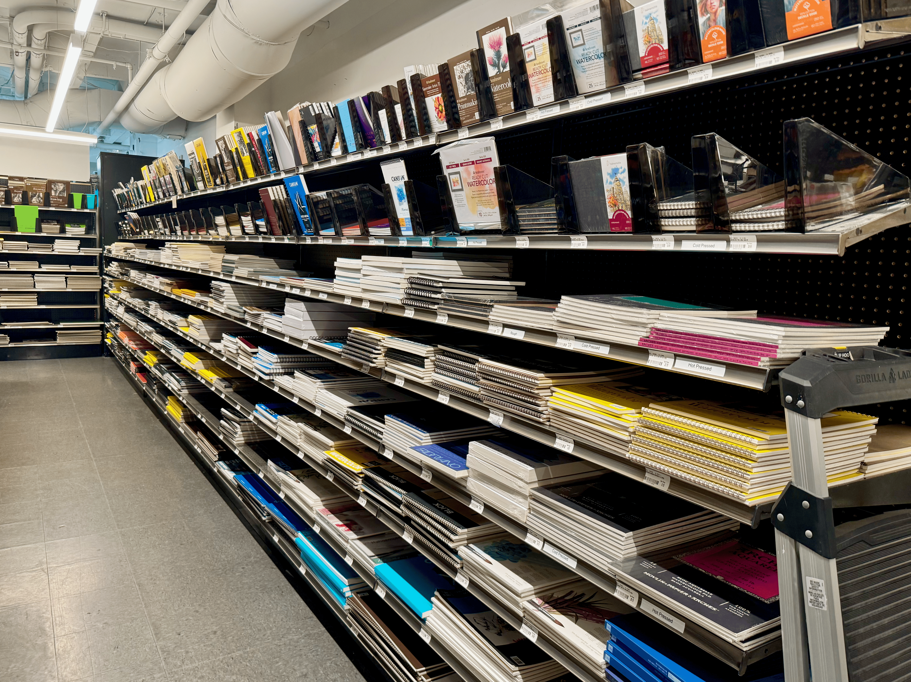

`6,886 words; 26 minutes`

> [!IMPORTANT]
> This is part 3 of 3. Read [**Part 1—Paint**](https://jeremiahclark.com/?post=watercolor-1-paint#blog), and [**Part 2—Color**](https://jeremiahclark.com/?post=watercolor-2-color#blog) first.
>
> Also, **links in this article may be affiliate links**. If you use them to buy something, your price won’t be affected, but I’ll earn a small commission.

Now that we have our paints, we need the tools of the trade to make use of them.

---

## Paper

Paper choice is probably the most consequential factor in a successful watercolor painting. 
It’s not the most complicated—I just spent nearly 8,000 words on paint selection, after all—but paper is literally the foundation of every watercolor painting, and the sheer number of options can be daunting. 

The right paper will enhance your efforts, while the wrong paper will make your job harder than it needs to be, and may worsen or even ruin your final result.
With a limited budget, you’re better off buying student paints and professional paper. 
Brushes, which we’ll get to next, fall somewhere in the middle. 
Very important, but you only need to invest in a few to start with.

---

When evaluating paper, there are four qualities to be aware of:

1. Material
2. Finish
3. Weight
4. Format

### 1. Material

Watercolor paper is usually made from one of two materials—cotton or wood pulp—or a mix of the two.

> [!Important]
> Regardless of paper type, always ensure your paper is acid-free. 
If it isn’t, it’s likely to discolor surprisingly quickly.

**Cotton**

Good quality watercolor paper is made from 100% cotton. 
Always. 
Cotton paper is durable, less likely to be mangled by excessive working and reworking, and absorbs and holds watercolor paint more reliably when compared to wood pulp paper.

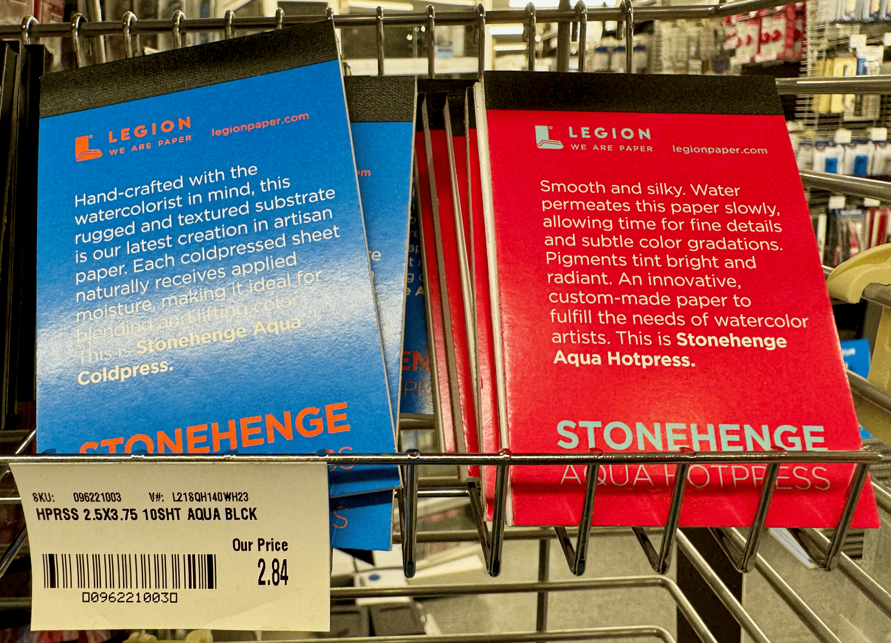

> [!Important]
> If the paper isn’t clearly labelled as “100% Cotton,” then it probably isn’t cotton paper. The mini Legion pads in the picture above are an exception (the full size pads include far more information about weight, content, etc.).

**Wood Pulp**

Most paper is made from wood pulp — often referred to as “cellulose,” but cotton is technically cellulose too, so “wood pulp” is more descriptive (Wikipedia Contributors, 2019).
It is less expensive than cotton paper, but also less durable and less absorbent. 
That lack of absorbency makes it harder to lay down smooth washes and gradients, and means paint will pool and puddle.

Cheap “student grade” watercolor paper and “mixed-media” papers are usually heavyweight wood pulp paper. 

It may be useful to keep some around for testing colors or doing quick sketches, but it should be avoided for real watercolor work.

**Blended**

Sometimes you’ll find blended watercolor papers. 
Blended papers contain some percentage of cotton, with the rest made up of wood pulp. 
Blended papers are intended to strike a balance between quality and affordability.

Higher cotton percentages will improve durability and absorption. 
If budget allows, 100% cotton paper is the gold standard.

**Cotton-Top**

Cotton-top papers are like two pieces of paper stuck together. 
One side is wood pulp and makes up the bulk of the paper’s thickness. 
The other side is a thin layer of cotton paper, giving you a better surface to work on. 
The goal is to produce a more affordable paper that still functions like expensive paper.

Cotton-top papers aren’t common—I’ve only seen them offered online—and I haven’t tried or even touched them myself. 
Because a cotton paper’s thickness aids in both stability *and* moisture retention, the compromise may not be worth it.

### 2. Finish

Watercolor paper is available in three finishes: 
Hot press, cold press, and rough.

**Rough**

Rough paper is exactly what it sounds like, a highly textured surface. 
The toothy, uneven surface will add a strong texture as paint pools in it and dries. 
This is especially noticeable with granulating pigments, which will show strongest on rough paper. 
Blends will also be more “active” as the mixing pigments interact with the texture before settling.

> [!TIP]
> A good choice if you want a highly textured result that emphasizes the physical nature of the medium. It’s not suited to all styles, though.

**Cold Press**

Cold press paper is pressed without the use of heat, resulting in a surface that is notably smoother than rough paper, but still has a definite texture and tooth to it. 
This is the most common finish for watercolor paper—it strikes a good balance between creating an interesting surface to work on without imposing too strong a texture on the paint.

> [!TIP]
> If you don’t have a preference already, **start with cold press paper**.

**Hot Press**

Hot press paper is pressed using heat—essentially ironed—following production, resulting in a smooth, even surface. 
Hot press paper is not as smooth as printer paper, but is far smoother than cold press paper. 
Hot press papers are easier to lift colors from, easier to scan and photograph, and will interfere the least with the inherent properties of the paint. 
Note that this smoothness will also mute granulation and will impact how wet on wet effects and washes blend.

> This is my personal preference in most cases. It most closely resembles my favorite paper for drawing—marker paper—which is very smooth. I’m trying to branch out, though, especially after seeing how hot press can cause problems with smooth washes.

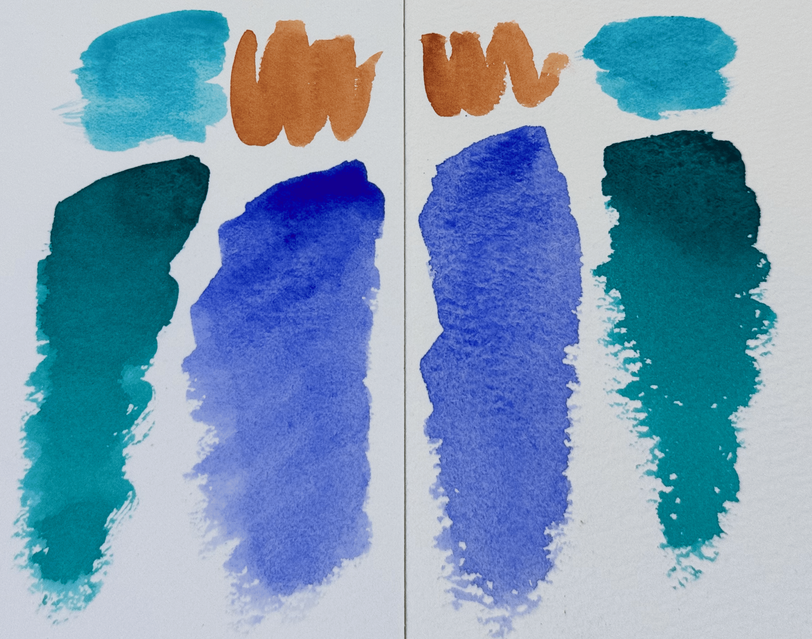

### 3. Weight

Watercolor paper is *thick.* A typical sheet of copier or printer paper will be around 14–24lb (52–90gsm). 
For watercolor, anything less than 140lb (300gsm) is generally unsuitable as it will warp under heavy washes. 
Thicker is often better—but that’s the minimum. 
Anything thinner will not stand up to the amount of water used in watercolor painting.

Many mixed-media papers are around 98lb (160gsm)—which does feel heavy compared to most drawing papers—which will buckle and start to fall apart under a heavy wash.

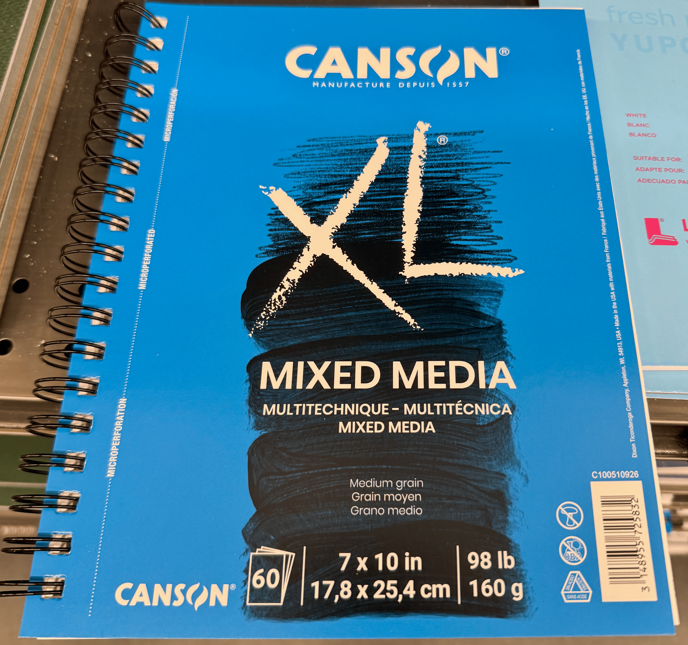

Watercolor papers up to 300lb (640gsm) are readily available, for a price. 
The advantage to such heavyweight paper is that it will stand up to even more water than regular watercolor paper without curling or buckling. 
The downside is that it will absorb and hold more water, meaning it will dry more slowly. 
It’s also more expensive and takes up more space, meaning fewer sheets per block or pad.

> [!NOTE]
> The simple takeaway is: **Never use paper less than 140lb (300gsm) for serious watercolor work**, and heavier paper may or may not be better, depending on your needs.

### 4. Format

Watercolor paper is available in at least three general forms, each with its own uses.

**Pads & Books**

These are your typical sketchbooks or sketchpads, bound on one edge with a spiral binding, or a sewn or glued binding. 
These are convenient and inexpensive, but are generally not the best for finished work. 
The spiral bound options in particular nearly always have wood pulp or blended paper, trading quality for convenience.

**Blocks**

> Blocks are by far the best way to do watercolor on the go.

Blocks are unique to watercolor, as far as I can tell. 
Watercolor blocks are like sketchpads, except they’re bound on at least two sides to a thick, stiff backing board. 
This keeps the top sheet flat, preventing curling and excessive wrinkling when it gets wet. 
When you’re done with that sheet, run a palette knife, or something similarly thin, all the way around under it to cut it free from the next sheet.

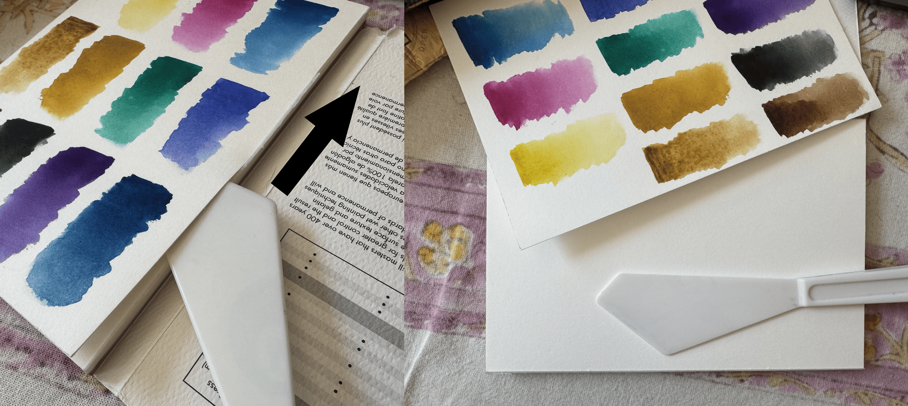

Avoid using an actual knife, as it's far too easy to cut into the next sheet down.

> [!TIP]
> I’ve seen people—even some highly experienced artists—separate sheets from a block by forcing their finger in between the sheets, often while complaining about how difficult it is. Don’t do that, it *is* difficult, because it’s wrong. It also risks wrinkling your work. Use a tool of some sort as described above.

**Loose Sheets**

Loose sheets are available in large sizes ideal for larger works. 
They give you the greatest flexibility, and can be cut into multiple smaller sheets. 
If you want, you can find instructions for turning large sheets into various styles of sketchbooks. 
If you’re crafty this can be an economical way to get a compact pad with very good paper at a reasonable price.

Another trick you can’t do with a sketchbook or block is to soak the sheet, then tape it down securely to your desk or a board as it dries. 
This will pre-stretch the paper and force it to dry flat, making it much more stable as you start painting.

### Paper Recommendations

Considering all of this together, here is what I suggest investing in to start with, and as you grow as an artist.

**Bulk Cheap Paper**

- 0–100% cotton paper
- 140lb (300gsm) minimum
- Around 7”×10” to 9”×12”

This isn’t going to be great paper, but for the price per sheet it serves a purpose. 
Use paper like this as scratch paper, or for testing paints and mixes. 
This is the one time I would consider paper that’s not 100% cotton. 
Do not use it for finished work, regardless.

- [150 Sheets 100% Cotton Watercolor Paper Bulk -140lb/300gsm Art Paper-8.5”×11”](https://amzn.to/3TpEj1i)—Bulk individual sheets. Not great, and my own experience with it casts doubt on the 100% cotton claim, but it's not bad given the price (I have theories, but that’s a rabbit-hole for another article). This is the cheapest way I’ve found to get lots of useable scratch paper.
- [Canson XL Series Watercolor Paper, Wirebound Pad, 7”×10”, 30 Sheets (140lb/300gsm)](https://amzn.to/47aQvWR)—A spiral bound sketchbook with heavyweight wood pulp paper. Not great, but both affordable and portable.

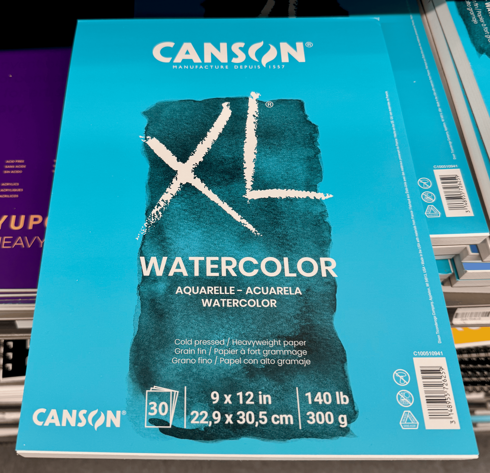

**Small Block**

- 100% cotton paper
- 140lb (300gsm) minimum
- 4”×6” to 8”×10”

This will let you practice on good paper without spending a lot. 
Small blocks in particular are good for carrying around if you want to try *plein-air* painting (painting outdoors). 
Most of the options below are available in a number of sizes and finishes.

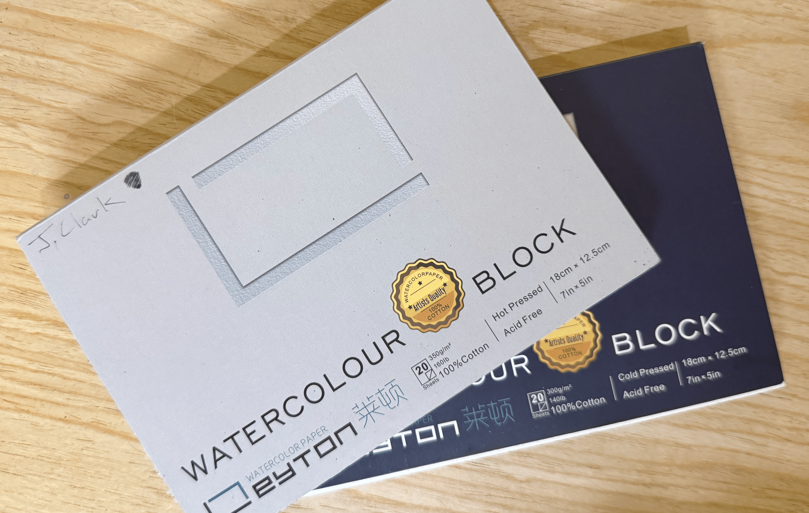

- [PaperPop Watercolor Block 5”×7”-20 Sheets, 160lb 100% Cotton](https://amzn.to/4j5L6rl)—My personal favorite so far. Slightly heavier than normal watercolor paper, but just a little, for a great price.

- [Fluid 100 Watercolor Block 4”×6”-15 Sheets, 140lb 100% Cotton](https://amzn.to/46GR1eO)—Another good choice with some smaller sizes. Also available with 300lb paper.
- [FLUNBRATO Watercolor Block 4.7”×4.7”-80 Sheets, 140lb 100% Cotton](https://amzn.to/4hUe8I0)—This affordable block has surprisingly good paper for the price. It’s also bulky and doesn’t have a cover, so it’s not great for carrying around. I keep it on my desk so I always have decent paper on hand for doing quick tests of new paints or mixes.
- [Stonehenge Aqua 100% Cotton Mini Pad Set](https://amzn.to/47l5SMx)—Stonehenge paper is high quality at any size (Rainey, 2017, p. 6), but my favorite product is their mini pads. They’re small enough to tuck into any kit so you can always have a bit of nice paper with you. This sample set includes three each of: 140lb Cold Press, 140lb Hot Press, 300lb Cold Press, and 140lb Cold Press Black paper.
- [Saunders Waterford Legion Watercolour Block 7”×10”-20 Sheets, 140lb 100% Cotton](https://amzn.to/3TW2eFw)—I haven’t tried this paper myself, but it comes highly recommended as a more affordable alternative to Arches.
- [Arches Watercolor Block 7.9”×7.9”-20 Sheets, 140lb 100% Cotton](https://amzn.to/47GNY6T)—Arches is generally regarded as making the best watercolor papers. You pay for the privilege though.
- [Arches Aquarelle Travel Pad 6”×10”-15 Sheets, 140lb 100% Cotton](https://amzn.to/4i9UoS6)—Just for something different, here’s a spiral bound pad. Pricey, but a spiral sketchpad with good watercolor paper is a rare thing.

**Large Block**

- 100% cotton paper
- 140lb (300gsm) minimum
- 9”×12” or larger

Same as above, but on a larger scale. 
Though all watercolor blocks are portable, starting around 9”×12” they start to get a bit unwieldy, in my opinion. 
And given the price, I leave these for more serious studio work (which means I’ve rarely used them, as I’m still learning).

- [Arches Watercolor Paper Block 9”×12”-20 Sheets, 140lb 100% Cotton](https://amzn.to/4zp9MzT)—Just a bigger version of the previous Arches block.
- [Arches Water Colour Block, 300lb. 9"×12"](https://amzn.to/475fwTk)— The same as above but twice the paper weight. Note that since the paper is twice as thick, there are half as many sheets (10 instead of 20).
- [Arches Aquarelle Watercolor Block, 140lb. 18”×24”](https://amzn.to/4dsPBbI)—I wanted to include one of the larger sizes as well. Given the high price, I have yet to pull the trigger on one of these.

---

## Brushes

Brushes are one of those areas that can get very deep, but can also be kept pretty basic and still produce decent results.

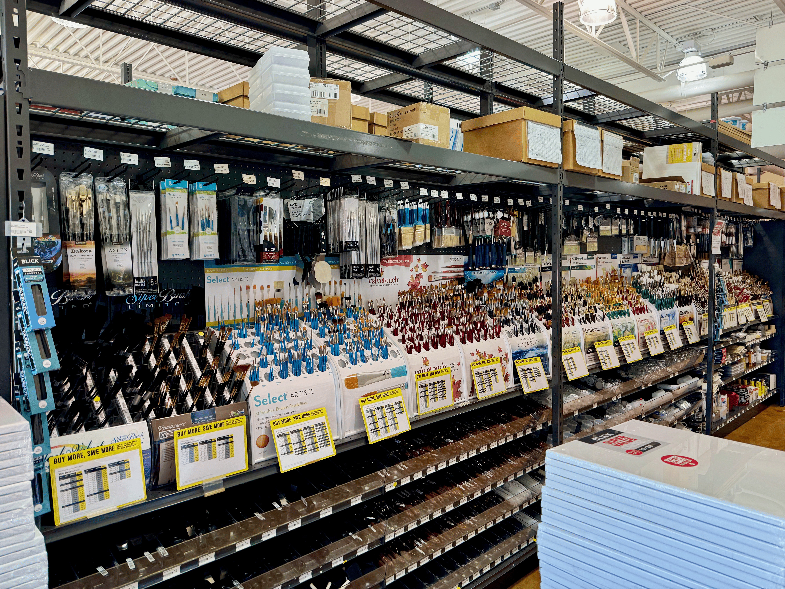

First, getting a few definitions out of the way will help with clarity:

- **Snap**—The tendency of a brush to return to its original shape after being bent (Rainey, 2022). With larger brushes, loading it with water and giving it a quick flick (but not in the direction of anything water-sensitive!) will return a quality brush to its original shape (Alnock, 2026).
- **Ferrule**—The part of the brush that holds the bristles to the handle. In many brushes this is a metal tube crimped around the end of the handle, and often filled with glue that holds the bristles. Cheap brushes will drop bristles after some use. Higher quality brushes will have better ferrules that are less likely to drop bristles (if well cared for). One simple sign of a good ferrule is the lack of a seam (Roebuck, 2018).
- **Belly**—The widest part of the brush between the ferrule and the tip. A larger belly will allow the brush to hold more water and pigment at once, allowing you to paint for longer without refilling your brush.

---

With that, let’s look at four defining features of brushes:

1. Material
2. Shape
3. Size
4. Form Factor

### 1. Material

When talking about brush material, we’re talking about what the actual brush bristles are made from. 
All brush bristles can be grouped into two broad categories: Natural and synthetic.

**Natural**

Before the wide availability of plastics, the only option was natural fibers. In a word, hair (or fur, technically). 
Many artists still swear by natural hair brushes, which tend to have superior performance in the areas that really matter to painters.

Natural hairs retain their shape well, readily snapping back into shape. 
Due to their slightly rough microstructure, natural hairs hold a surprising amount of water and pigment, and lay it down in a controlled manner (Wee Paint Brush, 2023).

The downsides include price, and the source of the hair. 
Obviously, natural hair has to come from somewhere. 
That “somewhere” is the international fur trade, with all the possible ethical concerns that entails (Bullaro, 2017). 
The whole issue is complicated, and I’m not going to take a stand one way or the other here—it’s up to each of us to decide how we feel about that, and act accordingly.

**Common Types:**

- **Sable**—Sable hairs come from sables, martens, or weasels, and are generally considered the best natural bristles for most brushes. Sable brushes have excellent snap and water retention. Sable brushes are the best choice for detail and control.
- **Kolinski Sable**—Sourced from Siberian weasels, these are considered the best of the best, and are priced accordingly.
- **Squirrel**—Squirrel hair bristles are more affordable than sable but have less snap due to their relative softness. Squirrel brushes work well for washes, and are probably the best option for a newcomer looking at natural bristle brushes.
- **Hog & Ox**—Used in flat brushes that benefit from being *very* stiff. Used far more in oil brushes than watercolor.
- **Goat**—Goat bristle brushes are *very* soft and don’t really fully snap back. Used mostly in Japanese calligraphy.

**Synthetic**

If you want to avoid natural bristles for ethical or cost reasons, there are plenty of synthetic options to suit your needs. 
Many good synthetics are designed to mimic the feel and function of natural fiber brushes; i.e., synthetic sable is stiffer and good for control while synthetic squirrel brushes are softer and good for washes (Rainey, 2021b).

Given the vast number of synthetics on offer, which vary significantly by manufacturer, a full accounting is beyond the scope of this article.

**What about the handles?**

Brush handles are usually made from wood or plastic. 
They can be fat, skinny, long, or short. 
Both the shape and length of the handle are a matter of personal preference and don’t directly impact performance.

> I prefer handles on the shorter side for ease of handling. Think the length of a pencil, or a bit longer. That’s as good a place as any to start, but it’s entirely up to you.

### 2. Shape

Brushes come in a dizzying variety of different shapes, each of which is intended for a particular use. 
There also tend to be multiple names for many shapes. 
What I’m listing here are the ones I’ve seen the most often. 
Just be aware this isn’t an exhaustive list.
For more, see Blick Art Materials (2025).

- **Round**—The most versatile shape is a pointed round brush. The point allows for detail, while the “belly” of the brush can be used to make wide strokes. If you only buy one brush, make it a round brush.
- **Flat**—As the name suggests, these brushes have a flat-ish rectangular or oval cross section and a flat tip. These are good for washes.
- **Filbert**—A flat brush with a rounded, instead of a flat, tip, making it a bit more versatile.
- **Dagger/Striper**—A flat brush cut at an angle rather than flat. These are highly versatile but take a more practiced hand to control than a round brush.
- **Cat’s Tongue/Oval Wash**—Basically a pointed brush with the cross section of a flat brush.
- **Mop**—Generally large soft brushes with a pronounced “belly” that allows them to hold a lot of water. Good for laying down large washes and, with enough skill, can make very capable general use brushes.
- **Detail**—Several varieties of fine-tipped brushes exist. Some are long (riggers or liners), some are short (spotters). All are intended for painting small details.
- **Inlaid Liner**—The most interesting detail brush type in my opinion, sometimes called extended needle point brushes. These are basically a liner with a huge belly, giving you control for detailed painting coupled with a huge load of water and pigment.
- **Wash/Mottler**—Like flat brushes but very wide. Technically these are two different brush types, but they both do something similar in watercolor painting, and that is, smoothly laying down a lot of water or paint over a large area.

### 3. Size

Watercolor brushes are available in a wide range of sizes, from extremely small detail brushes to massive mop brushes. 
There is no consensus among manufacturers about how to label sizes. Size is often indicated as a number like 2 or 6. 
Some brushes will indicate a width dimension, like 1/4” or 6mm.

There’s no hard and fast rule for when one convention is used over another, and one brand’s 4 might be another brand’s 2, or 6. 
Even brushes with actual dimensions may not be the same size, due to different standards for how to measure. 
The easiest way to be sure of a brush’s size is to see it in person.

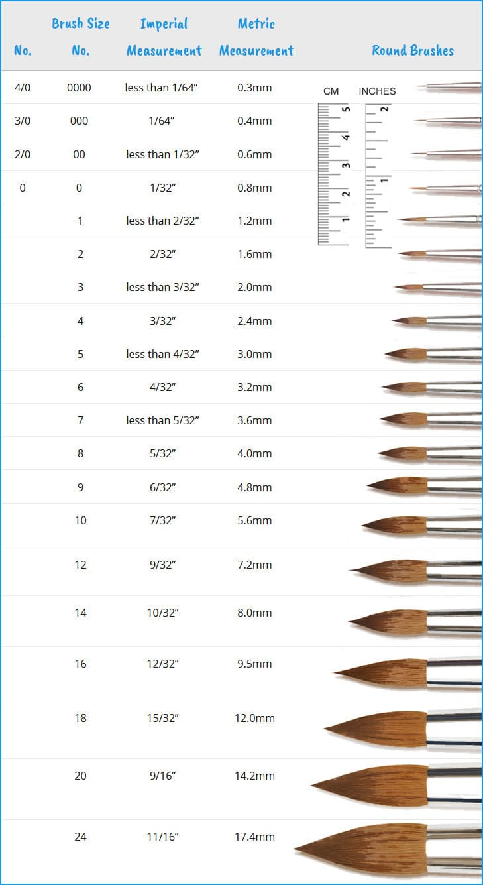

That said, we can set a few general guidelines (Sobuj, 2026):

- **Sizes 0–4** are small brushes, suitable for detail work.
- **Sizes 6–10** are mid-sized brushes, meant for general use.
- **Size 12** and larger are large brushes, for covering large areas.

It’s best to use the largest brush you reasonably can for the task at hand, especially at the start of a painting. This helps to avoid obsessing over details.

> [!TIP]
> If you’re painting out of half-pans, large brushes will be too large to easily get into them. Stick with small and medium sized brushes.

### 4. Form Factor

Most brushes can be divided into three broad categories:

- **Regular Brushes**—Most brushes fall into one large general category. Bristles of a particular type and shape attached to a handle using a ferrule.
- **Travel Brushes**—Similar to regular brushes except that the handle can be detached and reversed to cover the bristles for travel. All of the travel brushes I’ve seen have been round, detail, or narrow flat varieties, since the bristles have to fit within the handle when reversed.
- **Water Brushes**—Nylon bristled brushes with hollow plastic handles that contain a water reservoir. A light squeeze pushes water through the bristles. These are very handy for a travel kit since they contain their own water. On the other hand, the bristles are pretty bad, and it can be hard to avoid using too much water. The water brushes I’ve seen have all been round or flat. Mostly useful for quick and easy sketches.

### Caring for Your Brushes

Paint brushes are an investment, but one that can last a long time if you follow a few simple rules to care for them (Rainey, 2021a):

1. **Always clean your brushes immediately after use.** Watercolor comes out easily when wet (though it may stain, especially with cheap nylon bristles like water brushes use), but if it’s allowed to dry, it may permanently damage the bristles or ferrule.
2. **Do not leave your brushes in water.** Rinse them, then remove them from the water. Letting them sit risks loosening the ferrule, and bending the bristles if it’s resting on the bottom of the water cup. 
3. **Avoid submerging the ferrule completely into the water.** If water gets into the ferrule, it can damage the bristles, or loosen the ferrule by degrading the glue or corroding metal or wood components.
4. **Reshape the bristles before they dry.** After cleaning, when the bristles are still wet, reform them into their original shape if necessary. This is especially true with cheap or very soft bristled brushes.
5. **Dry laying down.** I used to dry brushes by putting them in a brush cup point up, but that’s a mistake. Point up allows water to run down and collect in the ferrule, where it can loosen the glue or degrade the bristle or handle materials.
6. **Protect the bristles.** Whether it’s a cup, a travel case, or anything else, brushes are best stored bristle end up. If they need to be stored laying down, take measures to ensure the bristles are not being bent.

### A Few Brush Recommendations

If you’re just starting out, it’s best to keep it simple with a few well chosen brushes (Voloshin-Smith, 2024, pp. 5–6):

- Get **at least one round mid-sized brush.** This will be your general purpose workhorse. Honestly, just this one brush is a good place for most beginners to start. I have a few brushes and tend to use one size 8 round brush most of the time.
- If you want to branch out, **a larger flat or filbert brush is a good second pick**, making washes and gradients easier to create. Size 12 would be a good size for this.
- If you really want a third brush, **either a wash or a detail brush, depending on the sorts of painting you’re doing.** Maybe both, for flexibility.

Starting out, this three or four brush kit should get you a long way. 
That’s especially true if you’re able to spring for decent quality brushes and care for them properly. 
I don’t mean you should shell out a couple hundred for a top-tier brush, just avoid the bargain basement options.

> These are from my experience and research. My limitation is I’ve followed my own advice, which means I haven’t tried that many different brushes as I’m learning.

**Travel Brushes:**

I really like the portability of travel brushes, and they’re what I’ve used the most.

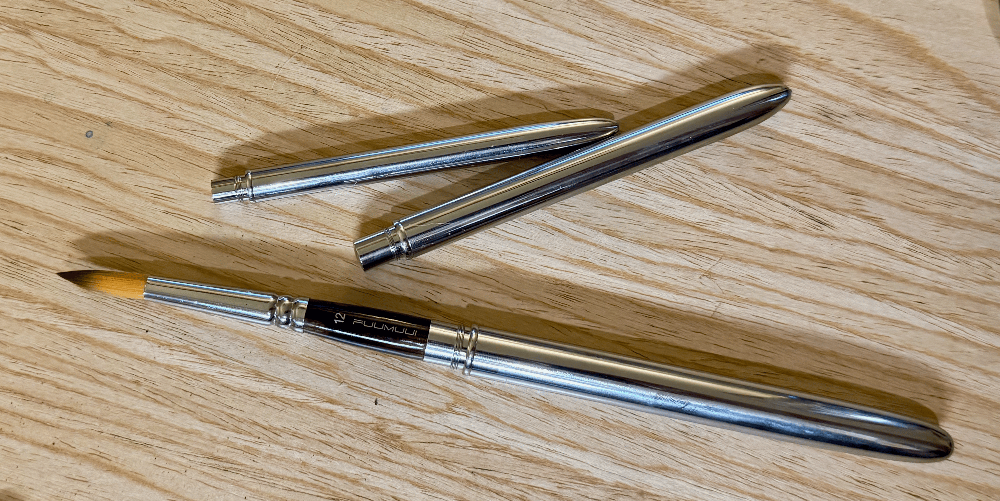

- [Fuumuui 3pcs Squirrel Hair Travel Watercolor Brushes](https://amzn.to/4rV35mA)—I’ve had a previous version of this 3-brush set for a few years. It has three round brushes, one each small (#4), medium (#8), and large (#12). They’ve stood up well to my inexpert use, looking essentially brand new (aside from some expected dings and scratches from being carried in my bag). The #8 and #12 sizes are my most commonly used brushes.
- [Fuumuui 4pcs Sable Travel Watercolor Brushes](https://amzn.to/4zkgVRS)—A variant of the above, I haven’t tried this 4-brush set specifically, but the brushes are the exact style of the set I have, and the price is very good for the variety on offer. It has a small and a medium round (which I can actually vouch for), a medium flat brush, and a medium dagger brush. That’s a pretty solid starter set and the one I’d buy for myself if I were starting over.

> [!NOTE]
> I should note that the 4-brush set claims to be Kolinsky Sable. I don’t know what to make of that, as the price doesn’t seem in line with the claim. I have to imagine there’s some technicality involved. I only know they’re quite good and well priced for natural bristle brushes.

**Regular Brushes:**

I have a few regular brushes that I bought early on, but nothing I’d really recommend—I chose poorly and/or didn’t know what I was doing and ruined them. 
With regular brushes, the really cheap options simply aren’t worth it. 
Instead, here are some mid-priced options I’ve seen recommended by artists I trust.

- [Princeton Series 4050 Heritage Synthetic Sable Brush Set](https://amzn.to/4dUrPWg)—The word on these brushes is they’re a great synthetic alternative to natural sable. This set includes a small round, a medium round, and a large round, as well as a large (1/2”) angled wash (Rainey, 2022).
- [da Vinci Series 5080 CosmoTop Spin Ultimate Wash Synthetic](https://amzn.to/4yBXtA1)—I’ve seen these wash brushes recommended as a good option for quickly laying down large areas of water or paint washes (Alnock, 2026).
- [Silver Brush Limited Black Velvet Round](https://amzn.to/4rPITlW)—These are a bit more expensive but are said to be pretty great. They use a mix of natural and synthetic bristles to strike a balance between cost and capability.
- [Escoda Aquario Gold Series 1140, Short Handle, Round Mop](https://amzn.to/4hShuvg) & [da Vinci Watercolor Series 418 Petit Gris Pur Pai, Wash/Mop](https://amzn.to/3VWPRd2)—For some context and comparison, these are professional level brushes. They’re expensive, but offer the best control and are the sort of brushes that will last a career if properly cared for (Alnock, 2026).

If you want to store or travel with regular brushes, you’ll need to put them into a case that’s meant for brushes. This is the one I have, it works fine: [MEEDEN Zippered Paints Brush Case](https://amzn.to/4y9yrXW)

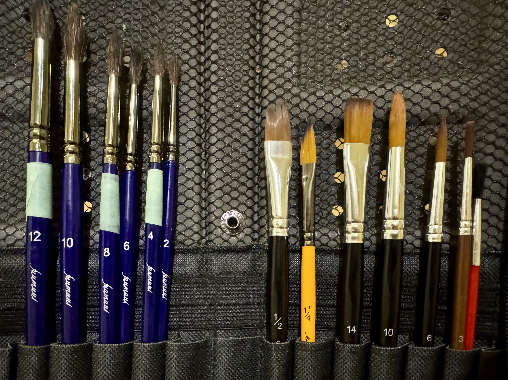

**Water Brushes:**

As I said before, water brushes aren’t great, but they’re VERY convenient. 
And to be fair, in the hands of a skilled artist—John Muir Laws, for example (Laws, 2012, p. 98)—water brushes can produce beautiful work.

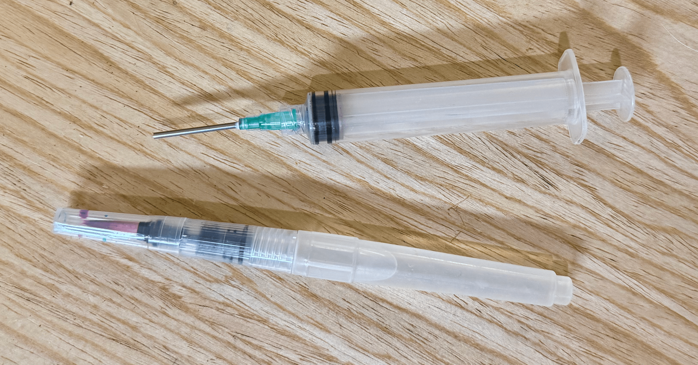

I carry a few around for quick sketches or just messing around. 
If you’re careful, it’s the most self-contained and least messy way to paint. I’ve even used them in the waiting room at a doctor’s office.

- [Mr. Pen Watercolor Brush Pens, 6 pcs](https://amzn.to/4BatvVK)—A basic, cheap water brush set. Includes three round and three flat brushes in three sizes each. The handles are flexible and squeezable along their full length.
- [JustArt Watercolor Brush Pens 6-Pack](https://amzn.to/47jVTad)—A similar but higher quality brush set that will likely last a lot longer. The handles are rigid aside from a small rubber squeeze area. Depending on how you hold them, they may work just fine for you, but for this reason I prefer the cheaper option above.

---

## Other Items

### Empty Case and Pans

As I said in a previous article, buying tubes of paint and filling pans is far more economical and flexible than buying prefilled pans.

But that means you’ll need empty pans and cases to put them in.

**Pans**

Filling empty pans from tubes allows you to easily reorganize or rework your palette with relative ease.

> [!TIP]
> I like to secure my pans with magnets. You can add magnets to regular pans, or buy them already included. Then you just need to get a metal palette box, or add magnets (like these: [200 Pack Small Magnets, 10x1mm](https://amzn.to/4hSee30)) or a strip of ferrous metal in the bottom of the well ([Steel Feeler Gauge, 0.3mm](https://amzn.to/3SJUWEy) cut to length works well). I use everyday super glue and it works well (roughing smooth plastic or metal before gluing helps).

- [100PCS Watercolor Half Pans](https://amzn.to/4ifn8YH)—Basic empty half-pans.
- [48Pcs Empty Watercolor Paint Pans](https://amzn.to/4yQiLKv)—Basic empty full-pans.
- [SEAMIART 24Pcs Empty Watercolor Half Pans Empty with Magnets](https://amzn.to/4xhV1gA)—Standard half-pans with strong integrated magnets. In my experience the orientation of the magnets is random, so pay attention if using magnets in the wells.
- [SEAMIART 24Pcs Empty Watercolor Full Pans with Magnets](https://amzn.to/4zoYs6D)—Standard full-pans with strong integrated magnets. The orientation is equally random in the set I ordered.

**Cases**

- [Bitray Small Size 15 Wells Airtight Palette Box](https://amzn.to/4jFYdiX)—My favorite portable palette case so far, this palette holds fifteen paints. It has a rubber sheet inside the lid that makes it airtight, which I removed (this would be useful for acrylic paints). Each well is separate which makes this palette feel very solid despite being inexpensive. It also adds some bulk, and it doesn’t leave the option of using full-pans. The top folds back flat, but being clear it doesn’t make for a very good mixing surface. I taped a paint cheatsheet and mixing guide to it instead (preliminary, needs some edits). Comes with regular half-pans that won’t jostle around, but will readily fall out.

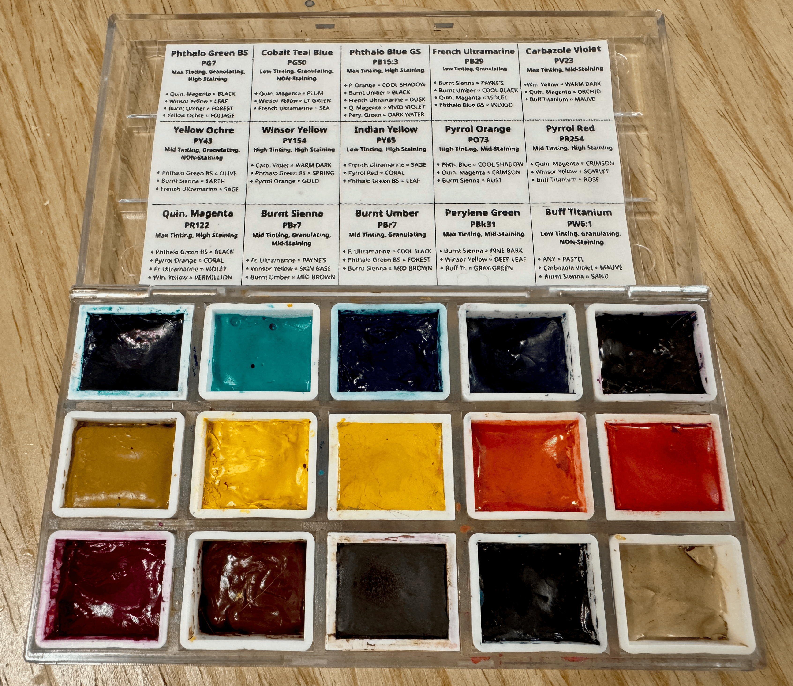

- [Piutouyar Portable Paint Palette Box for Watercolor, 12 Wells](https://amzn.to/4A9aPoE)—A rival for the top spot. It’s both more compact and cheaper. Since it doesn’t have individually divided wells, it’s very small but can accommodate twelve half-pans or six full-pans. Note that the lid does not fold fully back so it cannot be used as a surface for mixing. Comes with regular half-pans, which will jostle around and fall out if you don’t add magnets, double-sided tape, or similar.

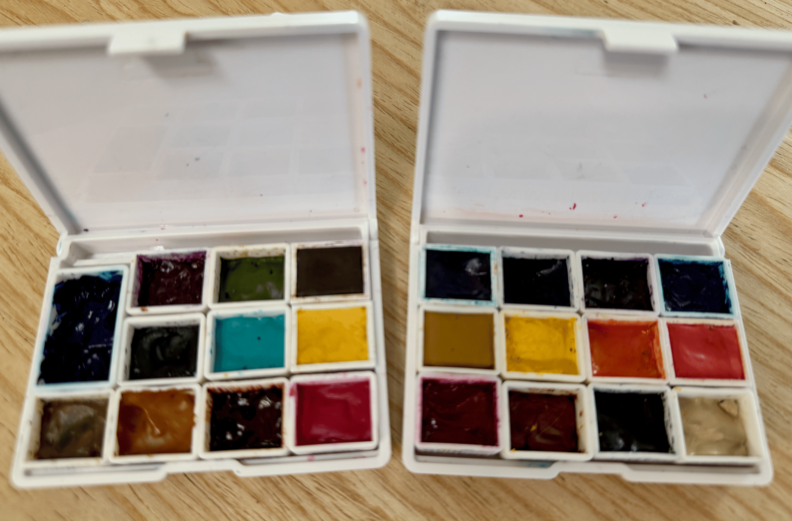

- [Piutouyar Portable Palette Box for Watercolor, 24 Wells](https://amzn.to/4AXsDDx)—This palette is very lightweight and will accommodate twenty-four half-pans, or twelve full-pans. The top folds back flat and can be used for mixing. Comes with regular half-pans.

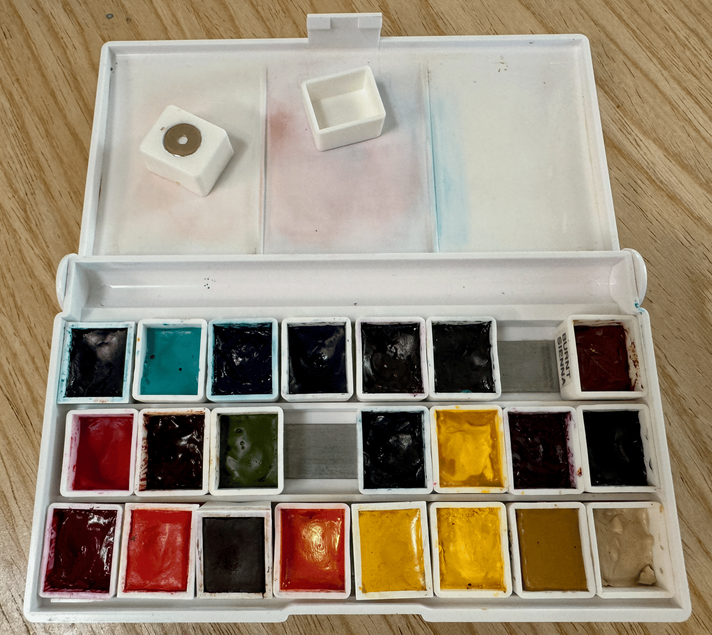

- [SEAMIART Stackable Empty Watercolor Paint Palette Box](https://amzn.to/4zp3Man)—This is a different design I only recently discovered. You pull the end off and slide pans in that way. It holds them tightly, which means magnets aren’t needed. In fact, the pans with integrated magnets are *slightly* too tall to fit. The removable lid is designed for mixing and is held on with magnets. You can buy additional bottom trays and stack them to carry more paints. Each tray can hold thirty-six half-pans or eighteen full-pans. Does not come with any pans.

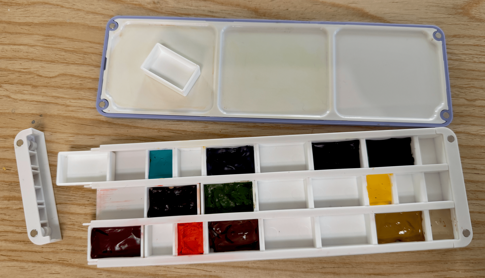

**Palettes**

You can also get palettes that have integrated wells not intended to be used with pans. 
These come in plastic, metal, and various ceramic varieties. 
Some fold or have covers. 
Ideally, the palette should have multiple, separated mixing areas so you can keep different color families apart for cleaner mixes (Laws, 2012, p. 98).

I haven’t really used any of these, but here are a few I’ve seen recommended and plan on checking out at some point:

- [Junreox Large Watercolor Paint Palette with Lid - 24 Wells with 5 Mixing Areas, Plastic 11.8”×10.6”](https://amzn.to/4B96y5m)—A *very* inexpensive folding plastic palette with lots of mixing areas that folds for easy transport (once dry).
- [Creative Mark Watercolor Palette with Cover – 42 Wells and 4 Mixing Areas, Plastic 12"×16"](https://amzn.to/4ynyIql)—Lots of room for lots of colors, and four separate mixing areas. Doesn’t fold, but has a cover.
- [Watercolor Palette with Wooden Lid - 24 Wells Porcelain 6.9”×11.2”](https://amzn.to/3UrnaEG)—A ceramic palette (it claims porcelain, given the price I have doubts) with a wooden cover that can double as a backing board for your paper. Note that the cover fits loosely, it’s meant to protect the paint from getting dusty, not to keep it from drying or to prevent spilling.

### Water Cups/Jars

Nothing special here, you just need a few cups or jars for water. 
A mug, an empty jam jar, a small vase, whatever. 
I will say, make sure that whatever you use is stable. 
Bowls or tall skinny containers have a tendency to fall over mysteriously… 
But maybe that’s just me.

Ideally you’ll have at least two containers of water. 
One for cleaning your brushes, and another for re-wetting your clean brush. 
Eventually the clean water will become cloudy and need to be replaced, but using two containers will make it last significantly longer. 
Three water containers (one for cleaning, one for a final rinse, and one clean) will work even better if you have space.

### Paper Towels, Rags, & Sponges

You should always have something on hand to wipe your brush. 
Not only to clean it, but also to remove excess water. 
Water control is a big topic all by itself.

> [!TIP]
> Fully loaded brushes—especially inexpensive brushes—may drip as they’re moving over your work, potentially ruining it. They also have a tendency to dump far too much water (and pigment) onto the paper as soon as they touch it. Lightly touching the tip to something absorbent before using it will greatly diminish the likelihood of these problems (Voloshin-Smith, 2024, pp. 45–46).

- **Paper Towels**—Cheap and readily available, paper towels will do the job. You may find they are not very economical though, as you’ll go through them quickly.
- **Rags**—Any sort of absorbent cloth will do. Since cloth rags are reusable, and will progressively dry as you work, they’re quite economical. I find old cotton t-shirts make for good watercolor rags.
- **Sponges**—Sponges work the same as rags, with the advantage of having a stable shape, and being easier to wring out. You can use basic kitchen sponges for this, or denser art or clay sponges (like these: [4 Pcs Round Painting Sponge, 2.96”](https://amzn.to/4BaDVEW)).
- **High-Density Sponges**—I’m not sure what these are actually called, but they’re my favorite sponges for this purpose, and deserve their own entry on the list. [Painting Sponge 3-Pack Water Absorbing Art Sponge for Watercolor](https://amzn.to/4B3OvgB). When dry, these sponges become rock hard and mostly non-absorbent. Wet them and they soften and become *ridiculously* absorbent. The way they work in practice is hard to explain, I’ve spent more time than I care to admit just playing with them. When dry, they’re fairly easy to cut to whatever size you need.

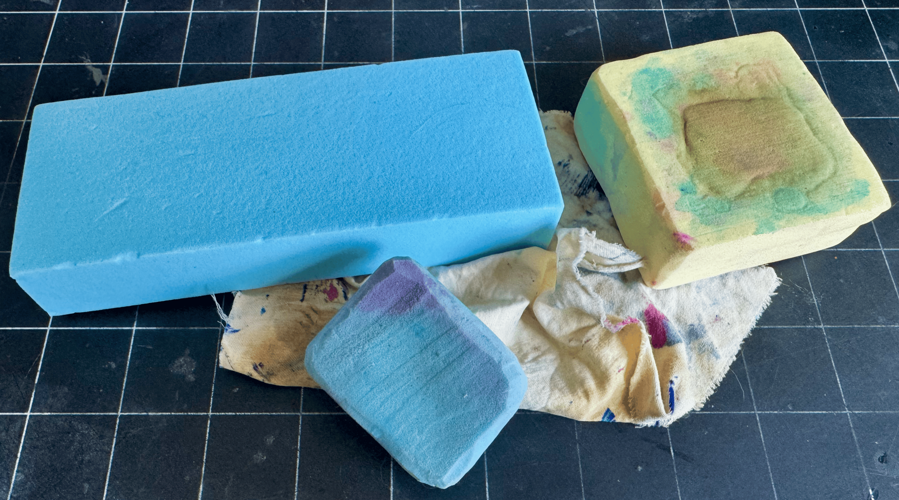

> [!TIP]
> I typically work with both a rag and a high-density sponge on hand. 
> Be aware that whatever you use for this purpose *will* become hopelessly stained.

---

## Quick Recap

This has been a long article, so I’ll summarize what you really need to get started:

- **Paper:** Small block, cold press finish, 100% Cotton, 140lb (300gsm) at minimum.  Bulk cheap paper for testing.
- **Brush:** One size 6 or 8 round, one size 12 or 14 flat or filbert, and an optional large wash or small detail brush.
- **Case or Palette:** Big enough to hold your chosen colors (6–24 colors), multiple separated mixing areas.
- **Water & Cleanup:** Two water jars and rags, sponge, or paper towels.

---

## That’s a wrap on Part 3

And almost 15,000 words later, we come to the end. 
All three entries in this series took far longer than I expected—especially this one, just look at that sources list!—which tells me both that I had a lot to learn (and still have, if I’m honest), and that this topic is worthy of exploration and dissemination.

I’ve covered the paint properties, color theory, and tools needed for watercolor painting. 
My approach has been mostly analytical, trying to quantify a messy topic with a long and organic history. 
I sincerely hope that I’ve helped to bring some order to the chaos. 
But, hopefully not *too* much. 

My aim was to provide a preliminary guide, to prevent the spinning wheels and crashing out common to new artists, not to remove all nuance and mystery—as if that would even be possible with any physical art medium.

---

## Where to Buy

Not everyone has dedicated, local arts and crafts suppliers. If you do it’s always best to buy paper and brushes in person. That allows you to hold, touch, and feel them before buying. Here are some of the stores I’ve visited (note that this list is US-only).

- [**Dick Blick Art Supplies**](https://www.dickblick.com/stores/)—Blick is a large chain with locations in 25 states plus DC at last count. My go-to since there is a location within an hour of my home. The selection, prices, and employees are as good as it gets for a brick and mortar art store in my experience.
- [**Artist & Craftsman Supply**](https://artistcraftsman.com/find-a-location/)—Artist & Craftsman is a mid-sized chain with stores in 11 states. I frequented the Maine location as a kid and into my twenties, until I moved south. Aside from not having store brand supplies, it is very similar in feel and offerings to Blick.
- **Sam Flax**—The Flax stores are a bit odd in that while they are related in some way, they are owned and operated individually. In that sense, there are multiple locally owned Flax locations in [Orlando](https://samflaxorlando.com/), [Atlanta](https://samflaxatlanta.com/), [Los Angeles](https://www.flaxpentopaper.com/), [San Francisco](https://flaxart.com/), and [Chicago](https://www.flaxartandframe.com/). I’ve only visited the Atlanta location, which is a labyrinthine, bohemian sort of store with all kinds of interesting nooks and crannies.
- [**Michaels**](https://locations.michaels.com/)—With the closure of Joann Fabrics, and ongoing scrutiny regarding the owners of Hobby Lobby, Michaels is the last non-controversial national crafting chain that most people in the US are likely to have nearby. There are Michaels stores in 49 of 50 states and DC, and while they are mostly dedicated to crafting they generally have decent options for sketchbooks, paints, and related tools.

If none of these options are convenient for you, you can always check out Walmart and Hobby Lobby, if your personal ethics allow it. And, of course, online retailers like [Amazon.com](https://www.amazon.com), [Blick’s online store](https://www.dickblick.com/), and [Jerry’s Artarama](https://www.jerrysartarama.com/) (which also has 21 [physical locations](https://www.jerrysretailstores.com/locations/) across 12 states, none of which I have visited) are an option as well.

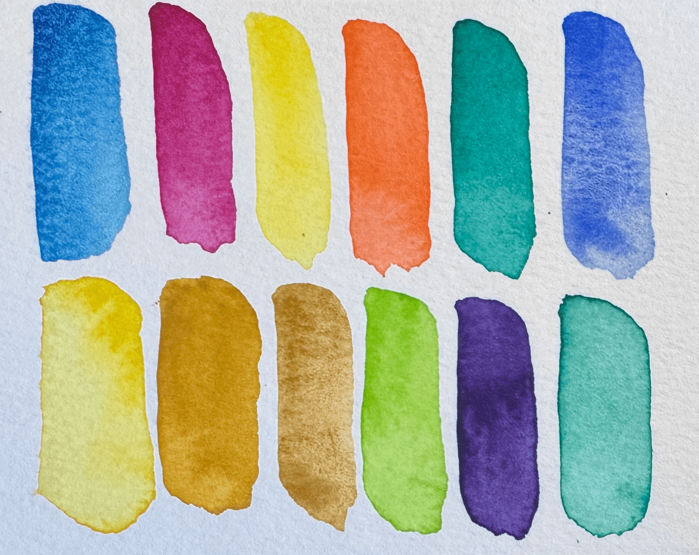

## Sources

### Articles

- Blick Art Materials (2025). *Brush shape differences | blick art materials*. [online] Dickblick.com. Available at: [https://www.dickblick.com/learning-resources/buying-guides/brush-shape-differences/](https://www.dickblick.com/learning-resources/buying-guides/brush-shape-differences/) \[Accessed 7 Oct. 2026].
- Bullaro, K. (2017). *Animal by-products and art supplies*. [online] Cowan Office Supplies. Available at: [https://cowans.org/blogs/cowans-art-knowledge-know-how/animal-by-products-and-art-supplies](https://cowans.org/blogs/cowans-art-knowledge-know-how/animal-by-products-and-art-supplies) [Accessed 17 Oct. 2026].
- Rainey, J. (2022). *The ultimate guide to the best watercolor brushes*. [online] jennarainey.com. Available at: [https://jennarainey.com/ultimate-guide-best-watercolor-brushes/](https://jennarainey.com/ultimate-guide-best-watercolor-brushes/) \[Accessed 7 Oct. 2026].
- Roebuck, A. (2018). *Watercolor brush size chart free PDF! - Watercolor affair*. [online] Watercolor Affair - Learn the Art and Techniques of Watercolor Painting. Available at: [https://www.watercoloraffair.com/watercolor-brush-size-chart/](https://www.watercoloraffair.com/watercolor-brush-size-chart/) [Accessed 17 Oct. 2026].
- Sobuj, M.J. (2026). *Paint brush sizes explained: Ultimate guide*. [online] Painting Pro Guide. Available at: [https://paintingproguide.com/paint-brush-sizes-explained/](https://paintingproguide.com/paint-brush-sizes-explained/) \[Accessed 7 Oct. 2026].
- Wee Paint Brush (2023). *The science of brush bristles natural*. [online] Paint Brush Manufacturer & Supplier, Custom Wholesale Brush Factory | Wee Paint Brush. Available at: [https://www.weepaintbrush.com/the-science-of-brush-bristles-natural/](https://www.weepaintbrush.com/the-science-of-brush-bristles-natural/) \[Accessed 7 Oct. 2026]. 
- Wikipedia Contributors (2019). *Cellulose*. [online] Wikipedia. Available at: https://en.wikipedia.org/wiki/Cellulose [Accessed 18 Oct. 2026].

### Books

- Laws, J.M. (2012). *The laws guide to drawing birds*. Berkeley, California: Heyday. Available at: [https://amzn.to/4xrKHTz](https://amzn.to/4xrKHTz) (affiliate link), and [https://bookshop.org/a/128387/9781597141956](https://bookshop.org/a/128387/9781597141956) (affiliate link).
- Rainey, J. (2017). *Everyday watercolor*. Watson-Guptill. Available at: [https://amzn.to/3WxRpud](https://amzn.to/3WxRpud) (affiliate link), and [https://bookshop.org/a/128387/9780399579721](https://bookshop.org/a/128387/9780399579721) (affiliate link).
- Voloshin-Smith, V. (2024). *Watercolor 101: Pocket guide*. Rocky Nook. Available at: [https://amzn.to/4gRmOjf](https://amzn.to/4gRmOjf) (affiliate link), and [https://bookshop.org/a/128387/9798888142219](https://bookshop.org/a/128387/9798888142219) (affiliate link).

### Videos

- Alnock, S. (2026). *Watercolor brushes I wish I knew about years ago. part one.* \[online] Sandy Paints. Available at: [https://www.youtube.com/watch?v=qTaXqnEGF7M](https://www.youtube.com/watch?v=qTaXqnEGF7M) \[Accessed 13 Oct. 2026].
- Rainey, J. (2021a). *Do’s and don’ts for long lasting watercolor brushes.* \[online] Jenna Rainey. Available at: [https://www.youtube.com/watch?v=sPv-E4nKbXs](https://www.youtube.com/watch?v=sPv-E4nKbXs) \[Accessed 13 Oct. 2026].
- Rainey, J. (2021b). *The complete beginner’s guide to watercolor*. \[online] Jenna Rainey. Available at: [https://www.youtube.com/watch?v=tDdfPMTX15Y](https://www.youtube.com/watch?v=tDdfPMTX15Y) \[Accessed 14 Oct. 2026].
