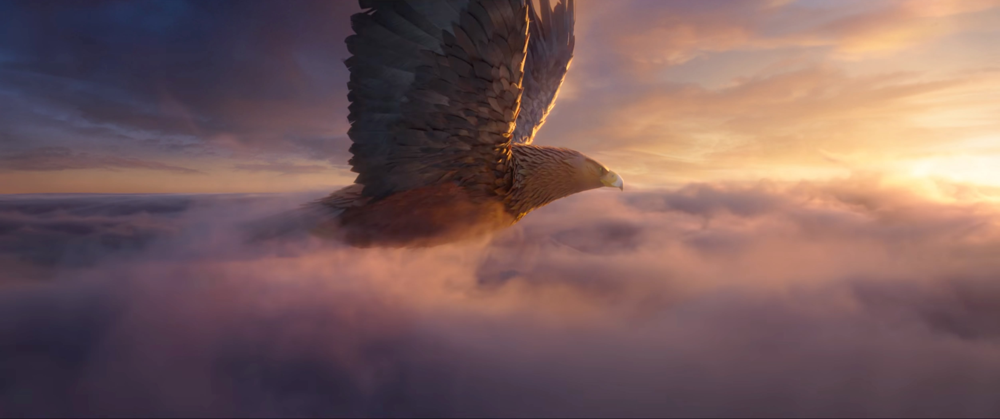
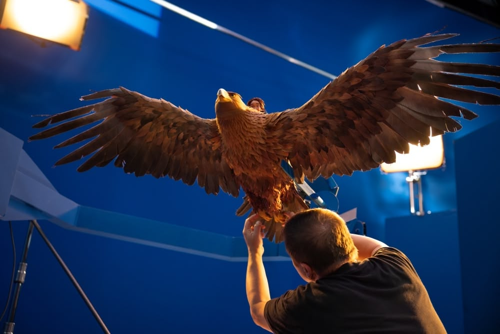
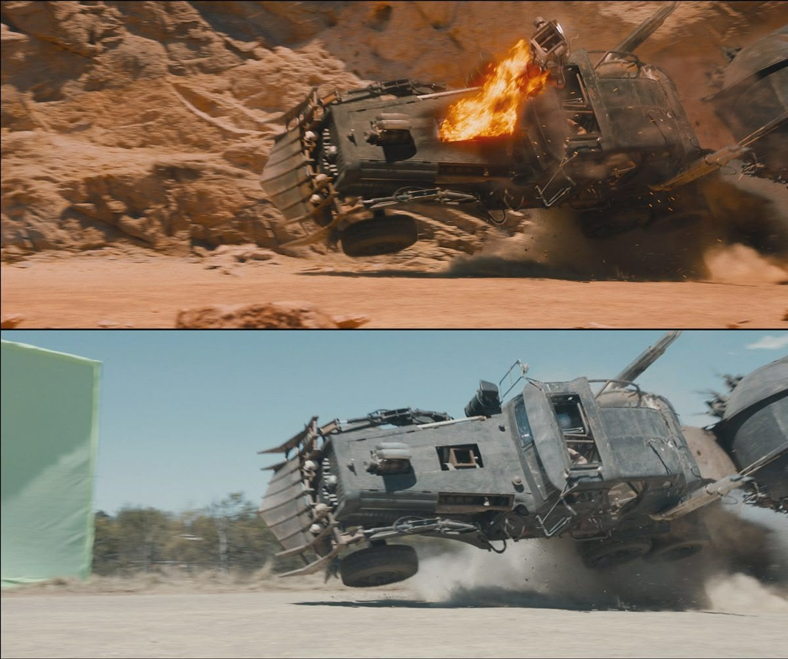
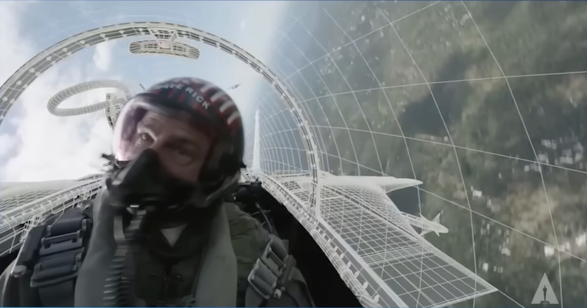
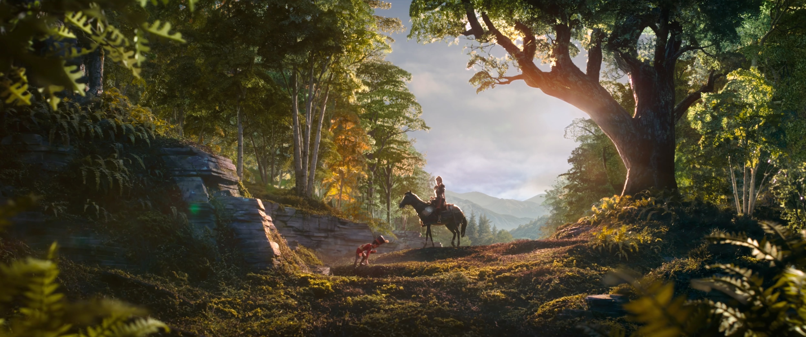
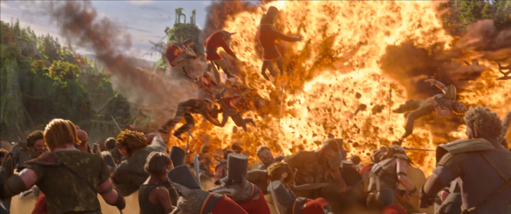

Wildwood, the latest stop-motion film from LAIKA—the studio behind *Coraline,* *Kubo and the Two Strings,* and *ParaNorman*—is out now, and it is a triumph.

> **Go see it.** Full stop. If there’s a showing near you as you’re reading this, stop reading and just go.

The craftsmanship on display is mind-boggling. 
Every frame of the over-two-hour runtime is filled with handcrafted props, characters, and worlds animated one frame at a time. 
Pre-production began in 2011, over fifteen years ago, and actual animation took five years to complete (McLean, 2026). 
The vision and dedication required to bring a project like that to fruition is beyond my comprehension. 
I’ve never had a job that lasted fifteen years, let alone a single project.

> **In the age of fast and disposable AI slop—and lazy non-AI filmmaking besides—that dedication and craft means something.**

## A Meld of New-School and Old-School Tech

The focus on being hand-made doesn’t mean there’s no modern technology involved. 
Quite the opposite. 
The faces, for instance, were first animated in CG—using live-action reference, a common practice in animation—then 3D-printed for every frame. 
Literally, every frame. 
That adds up to more than 142,000 faces for the whole film (SBNEnter, 2026). 
The eyes, on the other hand, were actual eyeballs integrated into the head and animated manually (McLean, 2026).

That balance is fascinating, allowing for facial performances to be directed and locked down before the body animation has even begun. 
Can you imagine the amount of forethought and coordination required to make that work? I can’t.

I’m reminded of *Mad Max: Fury Road,* which was rightly lauded for doing real stunts, using real functional vehicles, and shooting in the real world. 
And yet, nearly every frame of that movie has CG in it (Failes, 2015). 
It’s in the background, or filling in gaps, or removing safety harnesses and other filmmaking artifacts. 
But the key is that the action you’re focused on—the part carrying actual weight—is as real as a film can ever be. 

The same happened with *Top Gun: Maverick.* 
Despite what you may have heard, that film was dripping in CG—but for the most part it was used to enhance and support the real, not to conjure it from nothing (The Movie Rabbit Hole, 2023).  

You can feel the difference. 
It’s visceral, with fewer of those little cues to let your brain register that what you’re watching is fake. 
Even in full replacement shots like those in *Top Gun: Maverick,* the use of real reference makes a massive difference.

Now, clearly as an animation nothing in Wildwood is “real” in the sense of being real people doing real things. 
And yet, what you’re watching *is* real. 
It’s a physical reality with weight and texture and absolutely accurate light and shadows because—despite being designed and heightened as all cinematic lighting is—you are looking at real light and shadows. 
That physical reality registers alongside the artistry of the animated world and performances in a way no other medium can quite match.

Fire, smoke, fog, expansive backgrounds, and at least a small portion of the animation toward the end (I’m trying not to spoil anything) simply *must* be animated using means other than stop-motion. 
That’s true of any epic film, no matter how the principal filming is achieved. 
But the point is that to the extent possible, this movie is handcrafted by actual people. 
Mostly physically, occasionally digitally, but always *by people* with artistic purpose and vision.

> [!Note]
> Another little tidbit that didn’t really fit into the flow of the above: Most of the puppets had air bladders built into them that allowed them to breathe and flex muscles. It’s another of those details you don’t really notice, but you feel the difference.

## But, Is It Any Good?

All of that makes Wildwood a technical and artistic triumph, but is it a good film? 

> Emphatically, **yes. VERY.**

It’s been a long time since a movie has carried me away so thoroughly. 
It’s easy to forget that you’re watching puppets. 
Thinking back, some scenes in particular exist in my memory as scenes between real life actors. 
When the various factions came together in desperation to defend their world, I got goosebumps at the high drama. 
My adrenaline spiked during a final battle that reached a scale I wouldn’t have thought possible for stop-motion. 
I’m not embarrassed to say I was brought to tears more than once in quiet moments of grief and longing. 
The film craft is everything you could want from an epic feature.

And the story. 
Oh, the story.

It’s not particularly original in its particulars; it draws heavily from the entire canon of epic fantasy. 
Tolkien and C.S. Lewis and the Brothers Grimm, to name just a few. 
But that’s window dressing. The heart of it all—the characters behind the action and their interrelationships—was as alive and affecting as you could hope for.

In the end it’s about love and loss and growing up and trying and failing and still showing up when it really matters. 
How we deal with an unfair world, whether we embrace the chaos or try to force our preferred order upon it.

> [!Note]
> The story takes place in and near Portland, Oregon. If you’ve ever been to Portland—one of my favorite cities to visit—you’ll know they absolutely nailed it.

So yeah, go see it.

It’s one of the best movies in years, and a pinnacle of artistic expression and achievement. 
As of this writing it has taken in just under $32 million against a reported $100 million budget (The Numbers, 2026). 

That it’s not blowing up the box office is a crime.

---

## Sources

- Failes, I. (2015). *A graphic tale: The visual effects of Mad Max: Fury Road.* [online] fxguide. Available at: [https://www.fxguide.com/fxfeatured/a-graphic-tale-the-visual-effects-of-mad-max-fury-road/](https://www.fxguide.com/fxfeatured/a-graphic-tale-the-visual-effects-of-mad-max-fury-road/) [Accessed 3 Nov. 2026].
- McLean, T. (2026). *‘Wildwood’: The making of LAIKA’s magical stop-motion world.* [online] Animation Magazine. Available at: [https://www.animationmagazine.net/2026/10/wildwood-the-making-of-laikas-magical-stop-motion-world/](https://www.animationmagazine.net/2026/10/wildwood-the-making-of-laikas-magical-stop-motion-world/) [Accessed 3 Nov. 2026].
- SBNEnter (2026). *Wildwood (2026) Behind the Scenes: The Making of LAIKA’s Stop-Motion Animation.* [online] YouTube.com. Available at: [https://youtu.be/yuzanGtUIQc?si=gKH5V2gJuHp_vCKX](https://youtu.be/yuzanGtUIQc?si=gKH5V2gJuHp_vCKX) [Accessed 3 Nov. 2026].
- The Movie Rabbit Hole (2023). *“No CGI” is really just invisible CGI (1/4).* [online] YouTube.com. Available at: [https://www.youtube.com/watch?v=7ttG90raCNo](https://www.youtube.com/watch?v=7ttG90raCNo) [Accessed 3 Nov. 2026].
- The Numbers (2026). *Wildwood (2026) - Box Office and Financial Information.* [online] The Numbers. Available at: [https://www.the-numbers.com/movie/Wildwood-(2026)](https://www.the-numbers.com/movie/Wildwood-(2026)) [Accessed 3 Nov. 2026].
- Wikipedia Contributors (2026). *Wildwood (film).* [online] Wikipedia. Available at: [https://en.wikipedia.org/wiki/Wildwood_(film)](https://en.wikipedia.org/wiki/Wildwood_(film)) [Accessed 3 Nov. 2026].