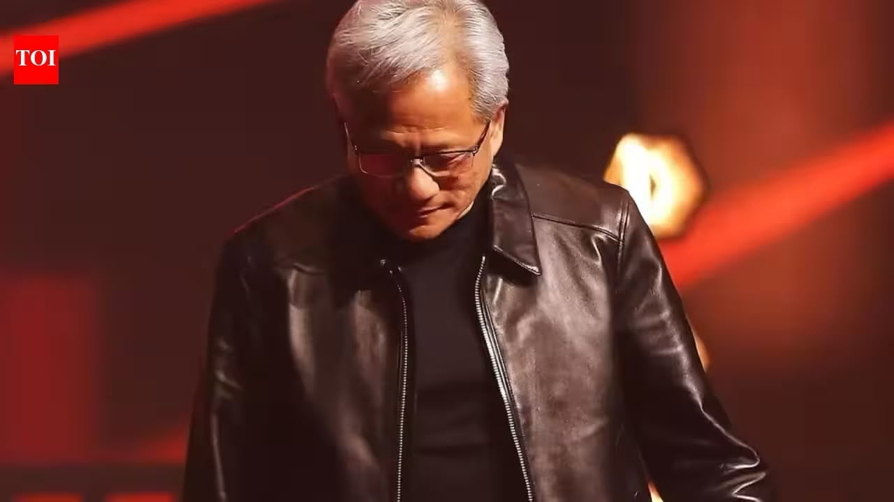
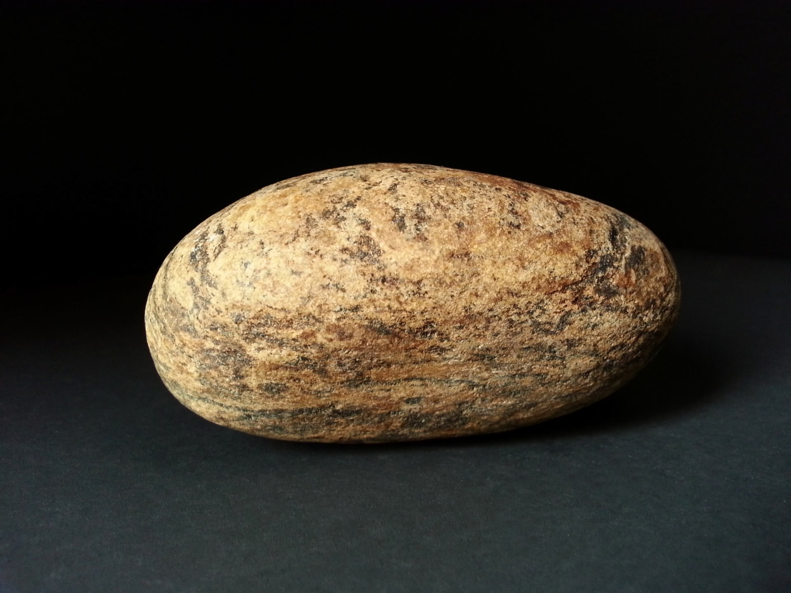
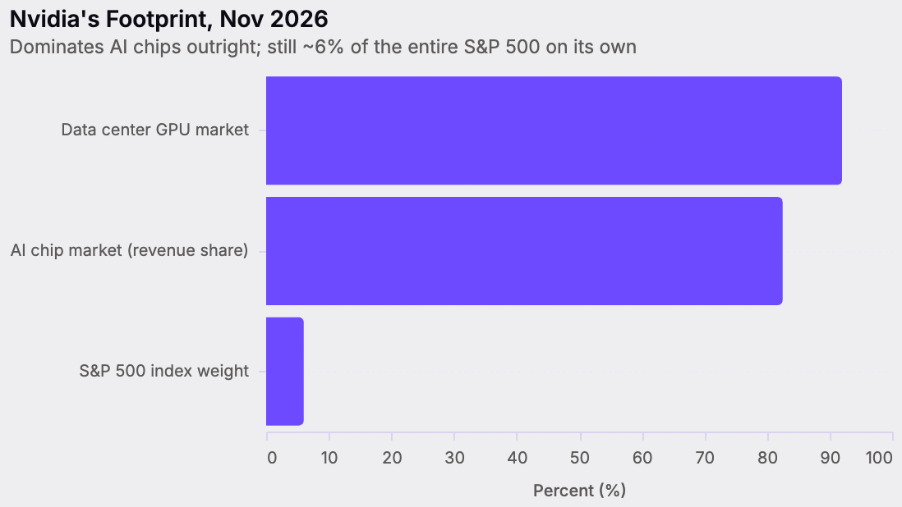
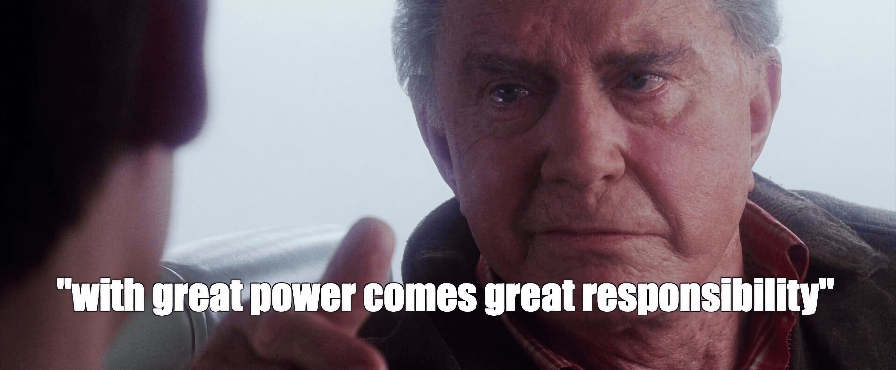

Following the revelations around Jensen Huang and his subsequent resignation—and just 11 days later, because we can’t have nice things, his reinstatement—SO MANY pixels have been spent defending him and his actions. 

> [!Tip]
> If you haven’t been following it, here’s the short version:  
> 
> Jensen Huang, CEO and co-founder of Nvidia, has admitted to multiple affairs, including two with direct reports and one with a suspected Chinese spy. Whether she is a literal spy isn’t important—she was funneling chips to Chinese companies either way. Huang and Nvidia knew it—or they should have, as the evidence seems overwhelming—and did nothing. The US government has been looking into it since at least 2024, but the President also opted to do nothing (Faulders, 2026).  
> 
> I’ll refer to the alleged spy as a Chinese “asset,” and let the investigation sort out the details of her complicity.

I’ve always found defending billionaires to be an odd impulse—they’re **billionaires.** They certainly don’t need your help, and they absolutely couldn’t give less of a shit about you or anyone else. 

**No matter how much you love the billionaires, they’ll never love you back.**

That said, one particular strain of that defense is particularly irksome to me. “Why do we hold executives to a higher standard?” plead wannabe thought leaders on LinkedIn. “They’re only human.” Some even lean on Bible quotes to defend his adultery, which is rich. I’ve literally seen “He that is without sin among you, let him first cast a stone” (John 8:7, KJV) invoked on social media. 

Well, I’ve never screwed around on my wife, I’ve never illegally sold anything to a foreign adversary, and I have this *just perfect* casting stone to hand, so… let’s do this.

You’re **damn right** we hold the officers of multi trillion-dollar corporations to a higher standard. Anything less is suicidally stupid. No one with that level of power and influence is allowed to be “only human” anymore. 

Sorry, *not sorry.* 

Depending on how it’s counted, through Nvidia Jensen Huang controls around 80–90% of the worldwide AI chip market—82.5% of AI accelerator sales (Sterling, 2026), and 92% of GPUs used in data centers (Fernandez, 2025)—and a market capitalization that would make it one of the largest economies in the world if it were a country (Amure, 2026). Nvidia alone is 6% of the S&P 500 (Crisolago, 2026)—30 times the average member.

Jensen is one of the handful of men holding the keys to the future, and he lacks the judgment to keep his pants on and not to sell AI chips to a Chinese asset—while also aggressively fighting legislation aimed at preventing exactly that. 

More galling is the fact that Jensen is supposed to be the *good* one. The adult in the room. Among Altman, Amodei, Musk, Zuckerberg, and Bezos, he’s more than 13 years older on average (only Bezos was born in the same decade)—and unlike many tech CEOs he actually is a talented engineer. He was born middle-class, attended public high school, initially went to a state university (at 16), and became a successful chip designer. He actually did co-found Nvidia (a lot of people call themselves “founders” unjustly), which started with only $600 and pioneered technology that drove—then rode—the waves of PC gaming, crypto, and now AI. (Jensen Huang, 2026)

How disappointing, then, to discover he’s just another tech bro when you get down to it.

> As an aside, I hope Huang’s presumably soon-to-be ex-wife, Lori, actually does take half of everything he has. She could join MacKenzie Scott in embarrassing her ex by using all that wealth—wealth that she was key in enabling—to do some actual good.

Broadening the view, this is the same argument I’ve been having for years. Someone in a position of power does something careless or capricious and people rush to their defense. It’s always the same weak apologetics.

“Everyone makes mistakes!” 

“Why hold them to a higher standard?” 

“They’re only human!” 

Spare me. 

Once a person attains a position of sufficient power or influence, they give up the luxury of being “only human.” That might sound unfair, but that’s the price of power. Or, it would be in a well-ordered society.

Wealth isn’t the only kind of power I have no patience for coddling. The same rule holds true for doctors, surgeons, judges, politicians, prosecutors, the police, prison guards, bankers, soldiers, and even children’s caretakers and teachers. Often when things go wrong there are mitigating circumstances. Accidents and honest mistakes happen. That’s true and should always be considered. 

But an affair isn’t a mistake, *it’s a choice.* Knowingly selling to a foreign adversary, however obliquely, isn’t a mistake, *it’s a choice.* Choices made for lazy, greedy, lustful, or short-sighted reasons. And for that we can offer no margin, and accept no excuses.

> [!important]
> If your daily actions: a) dictate life and death; b) directly impact the lives of millions; c) define the very concept of justice; or d) safeguard people’s most precious commodities—then you should absolutely be held to a higher standard.  Full stop.

In all of these cases we need to know *without question* that we can trust the people in these positions to be honest and show good judgment not only when it is easy, but when it is hard. *Especially* when it is hard. 

**Without that there can be no trust and the system stops working.** 

The police wonder why people don’t trust them after they close ranks to protect officers who killed a sleeping woman after kicking in the door of the wrong apartment, or the shooting of a man laying on the ground with his hands up. The Supreme Court wonders why no one treats its shadow-docket rulings as impartial when, first, there’s a “shadow docket” at all, and second, so many of its actions are clearly aimed at furthering highly partisan political goals.

And now, once again, a wealthy and powerful executive gets away with behavior that would at the very least ruin our careers, and likely land us in jail. 

Because *money.* And still they question the outrage.

It’s especially rich that the people rushing to a CEO’s defense are usually the same who will argue that CEOs deserve their extortionistic salaries, stratospheric bonuses, and golden parachutes (even if the company they lead is currently burning to the ground) specifically *because* their actions and decisions are so very consequential. 

> [!important]
> If you want power and the rewards that come with it, you have to accept the responsibility as well.

But, I’m not a high-powered CEO, you say. I can’t possibly know what pressures they’re under or what the job *really* takes. That’s a fair point. 

The good news is, you don’t have to take my word for it! Here’s a high-powered CEO talking about exactly this issue:

> “You know, I think you have to hold yourself responsible. You have agency. You're the CEO of the company, for God's sakes. You have to have high standards and expectations. […]  I'm responsible for an entire industry. And so I think the pressure of being the CEO is high, *and it's supposed to be high.* It should not be an easy job. It shouldn't be a job that you take for granted.”
> 
> -Jensen Huang to Bloomberg’s Emily Chang, [The rise and reckoning of Jensen Huang (2026)](https://www.youtube.com/watch?v=JW5s9Md4U2U) 

Having neither a succession plan nor a corporate structure that can survive without you, is an interesting way to live up to that sentiment. Clearly the very best person to hang the future on.

---

## Sources

- Amure, T.O. (2026). *Nvidia is now worth more than every economy except two*. [online] TheStreet. Available at: https://www.thestreet.com/markets/nvidia-is-now-worth-more-than-every-economy-except-two.
- Crisolago, M. (2026). *Nvidia is about 6% of the S&P 500. if Jensen Huang is ousted, there’s no clear successor — Could chaos hit portfolios?* [online] Yahoo Finance. Available at: https://finance.yahoo.com/markets/stocks/articles/nvidia-6-p-500-jensen-230000817.html.
- Faulders, K. (2026). *Woman at center of Nvidia scandal was in touch with China’s top spy agency: Sources*. [online] ABC News. Available at: https://abcnews.com/US/woman-center-nvidia-scandal-touch-chinas-top-spy/story?id=138369034.
- Fernandez, J. (2025). *The leading generative AI companies*. [online] IoT Analytics. Available at: https://iot-analytics.com/leading-generative-ai-companies/.
- Jensen Huang. (2026). In: *Wikipedia*. [online] Available at: https://en.wikipedia.org/w/index.php?title=Jensen_Huang&oldid=1378948026.
- *The rise and reckoning of Jensen Huang | the circuit with Emily Chang*. (2026). [Video] Directed by Bloomberg Originals. YouTube. Available at: https://www.youtube.com/watch?v=JW5s9Md4U2U.
- Sterling (2026). *AI chips industry data*. [online] Sterlingcharts.com. Available at: https://sterlingcharts.com/sectors/ai-chips.
- TOI Lifestyle Desk (2026). *Jensen Huang and his iconic leather jacket: What psychology says about older men and dressing like a youngster*. [online] The Times of India. Available at: https://timesofindia.indiatimes.com/life-style/fashion/buzz/jensen-huang-and-his-iconic-leather-jacket-what-psychology-says-about-older-men-and-them-dressing-like-a-youngster/articleshow/136120405.cms.